# 데이터 모델 · ERD

## 1. 설계 원칙

| 원칙 | 내용 | 이유 |
|---|---|---|
| ID | 기기에서 생성한 **UUID 문자열**. 자동 증가 숫자 금지 (위젯 id만 예외) | 백업 · 복원 · 나중의 서버 이전에서 같은 ID를 그대로 씀 |
| 날짜 | `yyyy-MM-dd` 문자열 (LocalDate) | 결제일은 날짜 문제. 시간대에 흔들리지 않게 |
| 시각 | epoch millis (Long) | `created_at`, `updated_at`, `deleted_at` |
| 금액 | `amount_minor` Long + `currency` | 부동소수 오차 방지. KRW는 원, USD는 센트 |
| 삭제 | soft delete (`deleted_at`), 30일 뒤 정리 | 실수 복구, 백업 일관성 |
| 열거형 | 대문자 문자열 (`MONTH`, `CANCELLED`) | 숫자 코드보다 읽기 쉽고 백업 JSON이 안전 |
| 계산 값 | **저장하지 않음** | 결제 내역 · 누적 지출 · 아낀 돈 · 월 합계는 규칙에서 계산 (product-spec 2장) |

### 계산하는 값과 저장하는 값

| 저장 | 계산 |
|---|---|
| 첫 결제일, 주기, 기본 금액 | 회차별 결제일 · 다음 결제일 · D-day |
| 가격 변경 (`price_change`) | 회차별 금액, 인상 · 인하 표시 |
| 일시정지 기간 (`pause`) | 결제가 빠지는 회차 |
| 해지일 (`cancelled_on`) | 마지막 결제, 아낀 돈 |
| 사용 기록 (`usage_log`) | 월 사용 횟수, 1회당 비용 |
| 파티 멤버 · 분담 | 내 몫, 통계의 내 부담액 |

결제 내역을 행으로 저장하지 않는 이유: 주기 · 가격 · 일시정지를 고칠 때마다 과거 행을 다시 만들어야 하고, 그 과정에서 어긋난 데이터가 생기기 쉽습니다. 규칙만 저장하면 수정이 곧바로 모든 화면에 맞게 반영됩니다.

## 2. ERD

```mermaid
erDiagram
    SUBSCRIPTION ||--o{ PRICE_CHANGE : "가격 변경"
    SUBSCRIPTION ||--o{ PAUSE : "일시정지 기간"
    SUBSCRIPTION ||--o{ USAGE_LOG : "사용 기록 (3차)"
    SUBSCRIPTION ||--o{ PARTY_MEMBER : "파티 멤버 (3차)"
    PARTY_MEMBER ||--o{ PARTY_SETTLEMENT : "월별 정산 (3차)"

    SUBSCRIPTION {
        string id PK "UUID"
        string preset_id "프리셋에서 만들었을 때"
        string name
        string plan_name
        string category "VIDEO|MUSIC|SHOPPING|CLOUD|AI|READING|GAME|ETC"
        long amount_minor "기본 금액"
        string currency "KRW|USD"
        string cycle_unit "DAY|WEEK|MONTH|YEAR"
        int cycle_interval "1~99"
        string first_billing_date "yyyy-MM-dd, 체험이면 체험 종료일"
        string trial_started_on "체험 시작일, 없으면 체험 아님"
        string trial_outcome "NONE|PENDING|KEPT|CANCELLED"
        string status "ACTIVE|PAUSED|CANCELLED"
        string cancelled_on
        string payment_method "자유 입력"
        string reminder_mode "DEFAULT|OFF|CUSTOM"
        int reminder_days_before "CUSTOM일 때 0|1|3|7"
        string color_key "서비스 색 10종"
        string cancel_url
        string memo
        bool consider_cancel "해지 고민함"
        bool track_usage "사용 체크 (3차)"
        string party_split_mode "EQUAL|CUSTOM (3차)"
        long created_at
        long updated_at
        long deleted_at
    }
    PRICE_CHANGE {
        string id PK
        string subscription_id FK
        string effective_from "yyyy-MM-dd"
        long amount_minor
        long created_at
    }
    PAUSE {
        string id PK
        string subscription_id FK
        string start_date
        string end_date "null = 일시정지 중"
        long created_at
    }
    USAGE_LOG {
        string id PK
        string subscription_id FK
        string used_on "yyyy-MM-dd"
        long created_at
        long deleted_at
    }
    PARTY_MEMBER {
        string id PK
        string subscription_id FK
        string name "1~10자, 나는 저장하지 않음"
        long share_amount_minor "CUSTOM일 때만"
        int sort_order
        long created_at
        long updated_at
        long deleted_at
    }
    PARTY_SETTLEMENT {
        string party_member_id PK,FK
        string period PK "yyyy-MM (이번 달 기간 이름)"
        long settled_at
    }
```



### 컬럼 메모

| 컬럼 | 규칙 |
|---|---|
| `trial_outcome` | 체험이 아니면 `NONE`. 체험이면 `PENDING`으로 시작 |
| `status` · `cancelled_on` | `CANCELLED`일 때만 `cancelled_on`이 있다. 체험 해지도 `status = CANCELLED` + `trial_outcome = CANCELLED` |
| `pause` | 한 구독에 끝이 없는 행은 최대 1개. 기간은 겹치지 않는다 (Repository에서 검사) |
| `price_change` | 같은 구독 · 같은 `effective_from`은 1개 (unique index) |
| `party_member` | "나"는 행으로 저장하지 않는다. 인원 = 멤버 수 + 1 |
| `party_settlement` | 체크를 풀면 행을 지운다 (soft delete 예외: 기록 의미가 없음) |
| `color_key` | `theme-guide.md` 5장 서비스 색 이름 (`RED`, `BLUE` …) |

### 인덱스

| 테이블 | 인덱스 |
|---|---|
| `subscription` | `status`, `deleted_at` |
| `price_change` | (`subscription_id`, `effective_from`) unique |
| `pause` | `subscription_id` |
| `usage_log` | (`subscription_id`, `used_on`) |
| `party_member` | `subscription_id` |

## 3. Room에만 있는 테이블

| 테이블 | 컬럼 | 메모 |
|---|---|---|
| `widget_config` | `widget_id`(Int PK), `size`(`SMALL`·`MEDIUM`), `background_type`(`THEME`·`DARK`·`WHITE`), `updated_at` | 시스템 appWidgetId라 UUID 원칙의 예외. 백업 · 자동 백업에서 제외 |

## 4. DataStore

| 키 | 타입 | 기본값 | 백업 JSON | 자동 백업 |
|---|---|---|---|---|
| `theme_mode` | `LIGHT`·`DARK`·`SYSTEM` | `SYSTEM` | ✓ | ✓ |
| `notify_payment_enabled` | Boolean | true | ✓ | ✓ |
| `notify_default_days_before` | Int | 1 | ✓ | ✓ |
| `notify_trial_enabled` · `notify_party_enabled` · `notify_monthly_summary_enabled` | Boolean | true · true · false | ✓ | ✓ |
| `notify_time` | `HH:mm` | `09:00` | ✓ | ✓ |
| `month_start_day` | Int 1~28 | 1 | ✓ | ✓ |
| `usd_krw_rate` | Long (원) | 1400 | ✓ | ✓ |
| `default_payment_method` | String | – | ✓ | ✓ |
| `list_sort` | `NEXT_BILLING`·`AMOUNT`·`NAME` | `NEXT_BILLING` | ✗ | ✓ |
| `onboarding_done` | Boolean | false | ✗ | ✓ |
| `billing_date_hint_pending` | Boolean (온보딩 등록 후 홈 "결제일을 확인해 주세요" 카드) | false | ✗ | ✓ |
| `dismissed_cards` | Set<String> | – | ✗ | ✓ |
| `ads_installed_at` · `ads_last_interstitial_at` · `ads_interstitial_count_today` · `ads_count_date` | Long · Long · Int · String | – | ✗ | ✗ |
| `remove_ads_cached` | Boolean | false | ✗ | ✗ (Play에서 다시 확인) |

## 5. Room Entity 예시

```kotlin
@Entity(
    tableName = "subscription",
    indices = [Index("status"), Index("deleted_at")],
)
data class SubscriptionEntity(
    @PrimaryKey val id: String,                                         // UUID
    @ColumnInfo(name = "preset_id") val presetId: String?,
    val name: String,
    @ColumnInfo(name = "plan_name") val planName: String?,
    val category: String,                                               // VIDEO | MUSIC | …
    @ColumnInfo(name = "amount_minor") val amountMinor: Long,
    val currency: String,                                               // KRW | USD
    @ColumnInfo(name = "cycle_unit") val cycleUnit: String,             // DAY | WEEK | MONTH | YEAR
    @ColumnInfo(name = "cycle_interval") val cycleInterval: Int = 1,
    @ColumnInfo(name = "first_billing_date") val firstBillingDate: String,  // yyyy-MM-dd
    @ColumnInfo(name = "trial_started_on") val trialStartedOn: String?,
    @ColumnInfo(name = "trial_outcome") val trialOutcome: String = "NONE",
    val status: String = "ACTIVE",
    @ColumnInfo(name = "cancelled_on") val cancelledOn: String?,
    @ColumnInfo(name = "payment_method") val paymentMethod: String?,
    @ColumnInfo(name = "reminder_mode") val reminderMode: String = "DEFAULT",
    @ColumnInfo(name = "reminder_days_before") val reminderDaysBefore: Int?,
    @ColumnInfo(name = "color_key") val colorKey: String,
    @ColumnInfo(name = "cancel_url") val cancelUrl: String?,
    val memo: String?,
    @ColumnInfo(name = "consider_cancel") val considerCancel: Boolean = false,
    @ColumnInfo(name = "track_usage") val trackUsage: Boolean = false,
    @ColumnInfo(name = "party_split_mode") val partySplitMode: String = "EQUAL",
    @ColumnInfo(name = "created_at") val createdAt: Long,
    @ColumnInfo(name = "updated_at") val updatedAt: Long,
    @ColumnInfo(name = "deleted_at") val deletedAt: Long?,
)

@Entity(
    tableName = "price_change",
    foreignKeys = [ForeignKey(SubscriptionEntity::class, ["id"], ["subscription_id"], onDelete = ForeignKey.CASCADE)],
    indices = [Index(value = ["subscription_id", "effective_from"], unique = true)],
)
data class PriceChangeEntity(
    @PrimaryKey val id: String,
    @ColumnInfo(name = "subscription_id") val subscriptionId: String,
    @ColumnInfo(name = "effective_from") val effectiveFrom: String,
    @ColumnInfo(name = "amount_minor") val amountMinor: Long,
    @ColumnInfo(name = "created_at") val createdAt: Long,
)
```

- 1차 v1 스키마는 `subscription`, `price_change`, `pause`, `widget_config`. 3차 컬럼(`track_usage`, `party_split_mode`)은 v1에 미리 넣어 두고, 3차 테이블(`usage_log`, `party_member`, `party_settlement`)은 3차 작업 때 추가한다. 스토어 출시 전이면 v1을 고쳐 쓰고(`README.md` 예외), 출시 후면 Migration으로 추가한다.
- 도메인 모델(`core:model`)에서는 `LocalDate`, `Money(amountMinor, currency)`, enum을 쓰고 매퍼에서 바꾼다.

## 6. 백업 JSON 형식

파일 이름 `subcal-backup-yyyyMMdd.json`, UTF-8. kotlinx.serialization, 키는 camelCase.

```json
{
  "format": "subcal-backup",
  "version": 1,
  "exportedAt": 1793318400000,
  "appVersion": "1.0.0",
  "settings": {
    "themeMode": "SYSTEM",
    "notifyPaymentEnabled": true,
    "notifyDefaultDaysBefore": 1,
    "notifyTrialEnabled": true,
    "notifyTime": "09:00",
    "monthStartDay": 1,
    "usdKrwRate": 1400,
    "defaultPaymentMethod": "신한카드"
  },
  "subscriptions": [ { "id": "…", "name": "넷플릭스", "amountMinor": 17000, "currency": "KRW", "cycleUnit": "MONTH", "cycleInterval": 1, "firstBillingDate": "2024-07-02", "…": "…" } ],
  "priceChanges": [ { "id": "…", "subscriptionId": "…", "effectiveFrom": "2026-08-02", "amountMinor": 17000, "createdAt": 0 } ],
  "pauses": [],
  "usageLogs": [],
  "partyMembers": [],
  "partySettlements": []
}
```

| 규칙 | 내용 |
|---|---|
| 넣는 것 | 삭제하지 않은 행 전부 + 4장에서 "백업 JSON ✓"인 설정 |
| 빼는 것 | soft delete 행, 위젯 설정, 광고 기록, 온보딩 상태 |
| 불러오기 검사 | `format` 일치, `version` ≤ 앱이 아는 최신, 모든 행 파싱 성공, 참조 무결성(없는 구독을 가리키는 행). 하나라도 실패하면 아무것도 바꾸지 않고 "백업 파일을 읽지 못했어요" |
| 불러오기 적용 | 한 트랜잭션에서 모든 테이블 비우기 → 넣기 → 설정 덮어쓰기 → 알림 다시 예약 → 위젯 갱신 |
| 버전 올리기 | 스키마가 바뀌면 `version`을 올리고 `BackupV{n}` 클래스를 추가. 옛 버전은 `BackupV{n-1} → V{n}` 변환으로 읽는다. 왕복 테스트(내보내기 → 불러오기 → 같은 데이터) 필수 |
| 개인정보 | 백업 파일에는 결제 수단 · 메모 · 파티 멤버 이름이 들어 있다고 내보내기 화면에 안내 |
